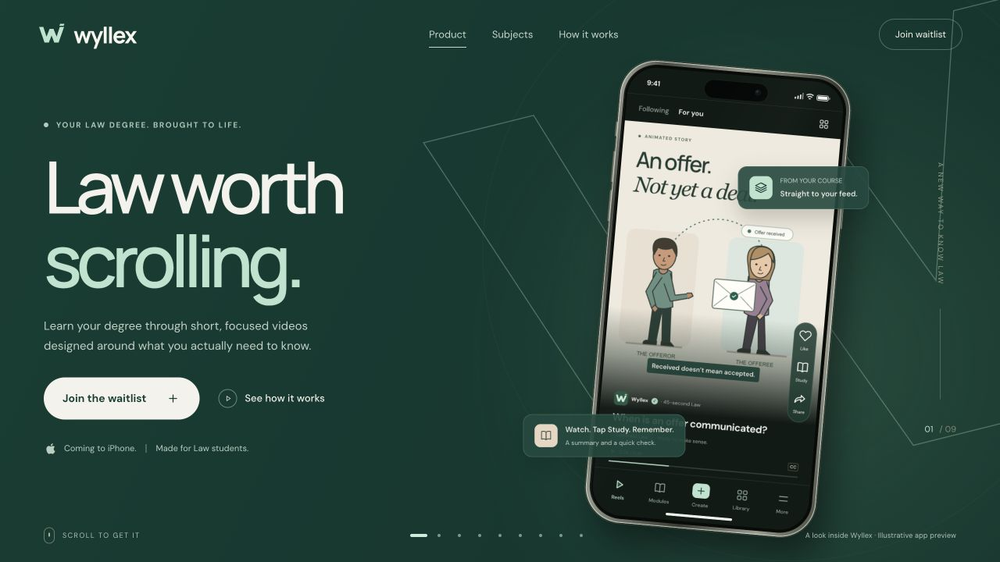
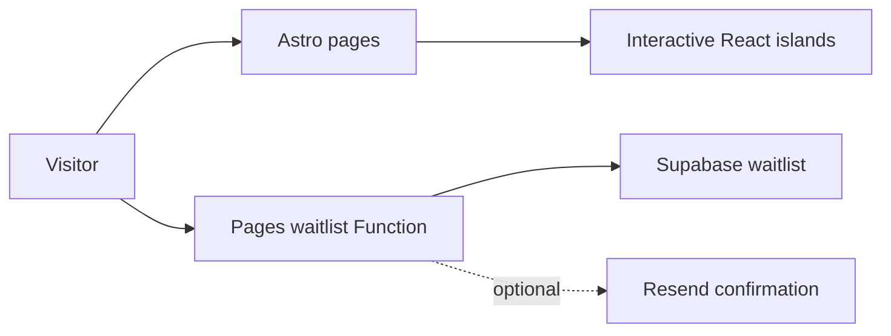

# Wyllex

### Law worth scrolling.

A product website for an upcoming iOS learning app for Law students. An interactive phone carries visitors from a first concept to a personalised learning feed, study tools and notes-to-reel creation, with an early-access waitlist at the end of the story.

**Astro · React · TypeScript · Tailwind CSS · GSAP · Cloudflare Pages**

[Visit wyllex.com](https://wyllex.com) · [Run locally](#run-locally) · [Configuration and deployment](docs/SETUP.md)



*The deployed website, captured in October 2026. The phone shows an illustrative app preview.*

## The experience

- **A product story in nine chapters:** subjects, a scrolling feed, different teaching formats, study aids, creation, focus and progress.
- **An interactive Law explorer:** eight subjects with keyboard-accessible navigation and concept previews.
- **An original visual identity:** forest green, paper and mint, with a folded-W mark and self-hosted typography.
- **Responsive motion:** desktop and mobile compositions, chapter navigation and a reduced-motion alternative.
- **A complete web foundation:** waitlist integration, privacy and terms pages, social artwork, sitemap, robots and a custom 404.

This repository contains the website and its waitlist Function. The iOS app is a separate product; the interface examples and statistics shown here are illustrative.

## Run locally

Requires **Node.js 22.12+** and npm. No service credentials are needed to explore the visual experience.

```bash
git clone https://github.com/Ale-Newport/Wyllex_web.git
cd Wyllex_web
npm ci
npm run dev
```

Open **[localhost:4321](http://localhost:4321)**. Scroll through the story, use its chapter buttons and explore the Law subjects. Stop the server with `Ctrl+C`.

Astro's development server renders the website but does not execute Cloudflare Pages Functions. The signup flow needs the Cloudflare emulator and configured Supabase values; an unconfigured signup shows a recoverable error instead of a false success.

### Preview the full waitlist flow

```bash
cp .env.example .dev.vars
# Set the Supabase values in .dev.vars using docs/SETUP.md.
npm run build
npm run pages:dev
```

The Pages emulator serves **https://localhost:8788** with a local development certificate. The [setup guide](docs/SETUP.md) covers the database migration, configuration, optional email and analytics, and deployment. No credentials are committed.

## Architecture



Static pages carry the narrative and metadata; React islands provide the interactive story, subject explorer and waitlist. A small Pages Function handles signup validation and database writes. Analytics and email are optional integrations.

| Path | Purpose |
| --- | --- |
| `src/pages/` | Landing page, legal pages, robots and 404 |
| `src/components/` | Product story, phone UI, subject explorer and waitlist |
| `src/config/` + `src/lib/` | Brand, site settings, content and shared behaviour |
| `src/styles/` | Typography, colour and responsive presentation |
| `functions/api/waitlist.ts` | Signup endpoint |
| `supabase/migrations/` | Waitlist schema and access policies |
| `public/` | Brand exports, social artwork and hosting headers |

## Commands

| Command | Purpose |
| --- | --- |
| `npm run dev` | Local visual preview |
| `npm run build` | Generate the production site in `dist/` |
| `npm run preview` | Serve the static build without the signup Function |
| `npm run pages:dev` | Run the Cloudflare Pages emulator |
| `npm run check` | Lint, unit tests and build |
| `npm run test:e2e` | Browser checks against the built site and emulator |
| `npm run assets` | Regenerate brand and social artwork |

Before running browser tests, build the site and install the browsers with `npx playwright install chromium firefox webkit`. Test setup and the release validation record are in [docs/validation.md](docs/validation.md).

The clean-clone install, local development server, production build and 26 unit tests were checked on **22 October 2026**. The public domain was also checked before linking it here. The earlier browser and accessibility results retain their original dates in the validation record.

## Further reading

[Brand system](docs/brand.md) · [Service configuration and deployment](docs/SETUP.md) · [Release validation](docs/validation.md)
